<p align="center">
  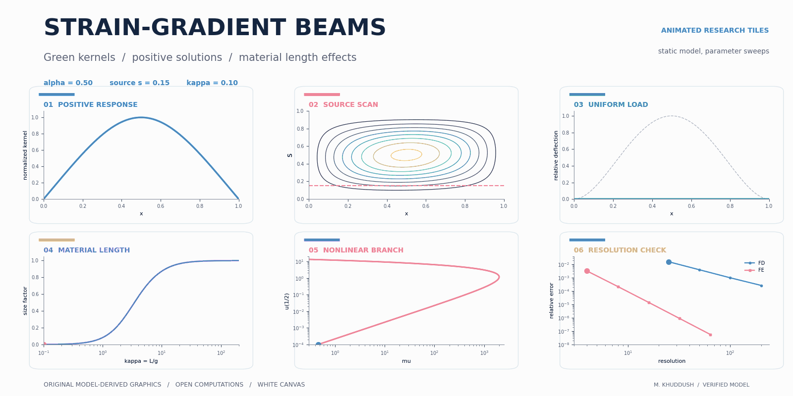
</p>

<h1 align="center">Sixth-Order Strain-Gradient Beam</h1>
<p align="center"><strong>Positive Solutions for a Sixth-Order Strain-Gradient Beam Boundary Value Problem</strong><br>Computational companion by Mahammad Khuddush</p>

<p align="center">
  
  
  
  
</p>

[](#quick-start)
[](#motion-gallery)
[](#numerical-results)
[](#verification)

🧠 **Green kernels** · 📐 **Sixth-order equations** · 🌈 **Original motion graphics** · 🧪 **Reproducible computations**

The positive inverse kernel connects the existence theory with three numerical methods: a Green–Nyström method, direct finite differences and mixed finite elements. The animations explore source position, material length, numerical equilibrium branches and mesh refinement. **They show static model calculations, parameter sweeps or camera motion. They are not time-dependent beam simulations.**

## Quick start

Use Python 3.11 or later. All displayed results and graphics are included, so browsing the repository requires no installation.

```bash
python -m pip install -r requirements.txt
python -m pytest -q code/tests
python code/scripts/verify_green_symbolic.py
```

The previous top-level entry point now uses the stable kernel and runs checks that stop on failure:

```bash
python Green_Verification.py
```

<details>
<summary>🛠️ Expand the complete reproduction workflow</summary>

Set `OPENBLAS_NUM_THREADS=1` and `MPLBACKEND=Agg` for predictable execution. Full cone-constant optimization can take several minutes.

```bash
python code/scripts/compute_results.py
python code/scripts/export_tables.py
python code/scripts/make_figures.py
python code/scripts/make_animations.py
python code/scripts/audit_revision.py
python code/scripts/check_package.py
```

On systems with GNU Make, `make all` rebuilds the results, tables and media; `make audit` runs the independent high-precision audit. Regenerate one animation with, for example:

```bash
python code/scripts/make_animations.py material_length
```

The animation names are `source_scan`, `kernel_surface`, `cone_estimates`, `nonlinear_branches`, `convergence`, `material_length` and `hero`.

</details>

## Motion gallery

### 🎯 Source position and positive response

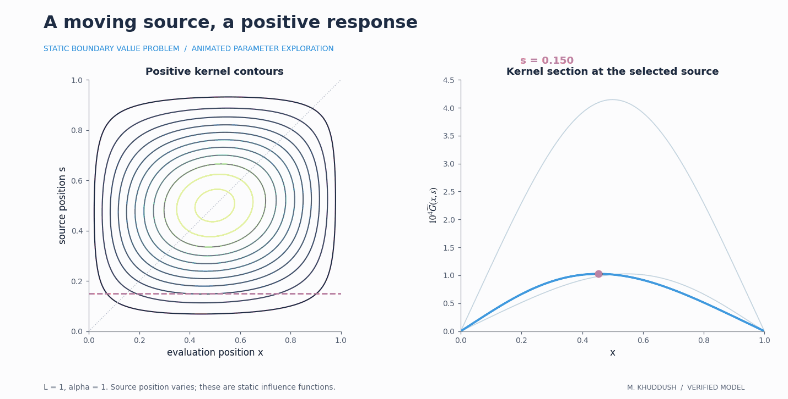

A horizontal cursor selects the source coordinate. The curve on the right is the corresponding positive response kernel, including exact zero endpoint values.

### 📏 Material length and maximal deflection

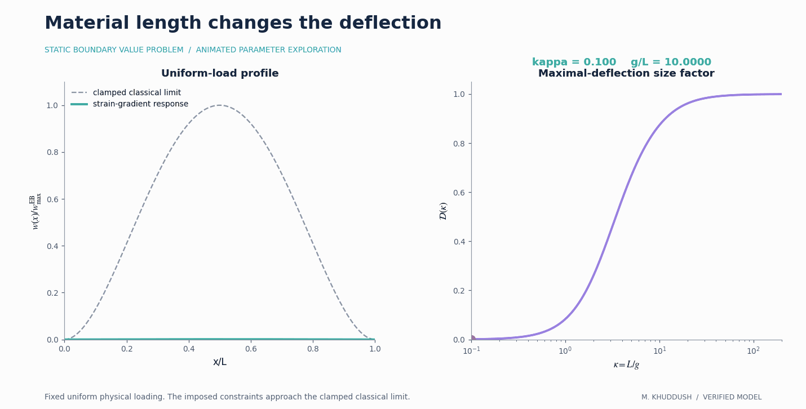

The uniform-load profile and size factor change together as (\kappa=L/g) varies. The dashed curve is the clamped classical limit for the imposed constraints.

<details>
<summary>🌀 Open the rotating Green-kernel geometry</summary>

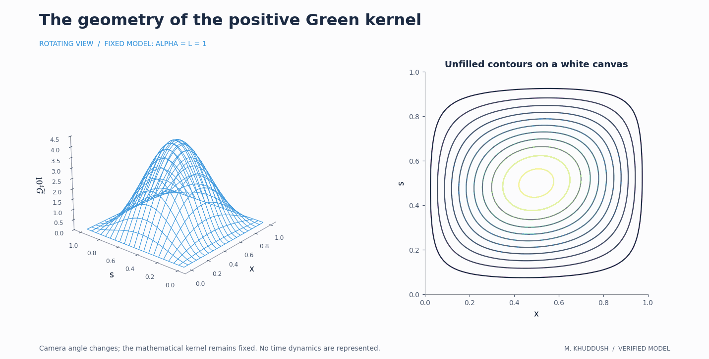

The camera rotates around a fixed positive kernel. The unfilled contour map shows the same data. [Open the full-size GIF](assets/animations/kernel_surface.gif).

</details>

<details>
<summary>🧩 Open the cone-bound exploration</summary>

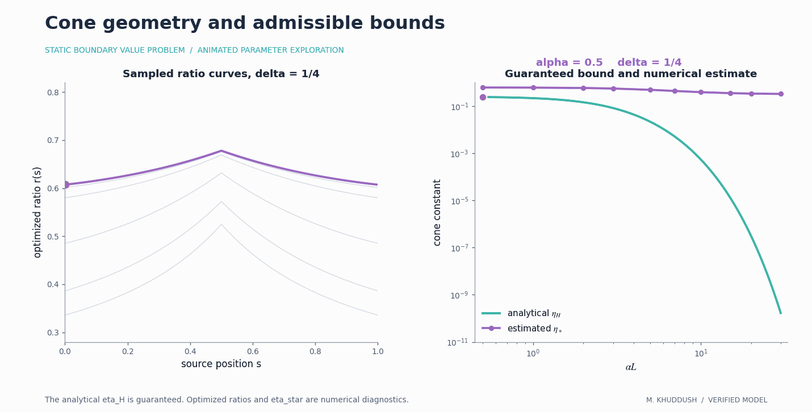

The explicit analytical constant `eta_H` is suitable for the existence proof. Optimized ratios and `eta_star` are numerical diagnostics. [Open the full-size GIF](assets/animations/cone_estimates.gif).

</details>

<details>
<summary>🔀 Open the nonlinear equilibrium branches</summary>

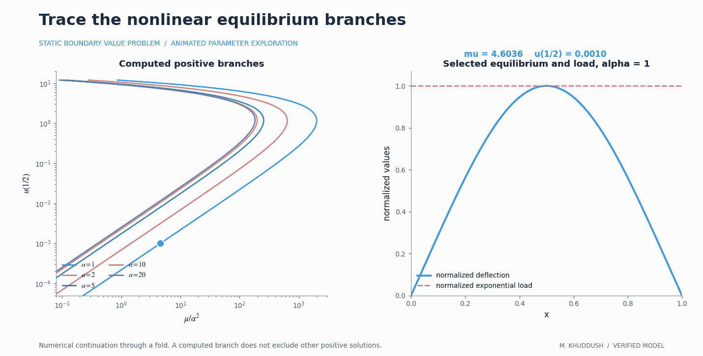

The selected point follows a computed exponential-load branch through its fold. The right panel shows its normalized deflection and normalized exponential load. A numerical fold does not establish a global nonexistence threshold. [Open the full-size GIF](assets/animations/nonlinear_branches.gif).

</details>

<details>
<summary>🔬 Open the mesh-refinement animation</summary>

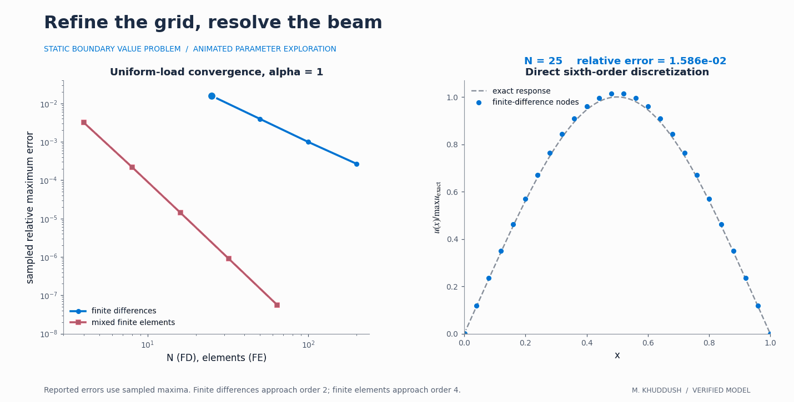

Four actually computed grids cycle through `N=25,50,100,200`. The moving cursor highlights nodal values; the left panel compares the recorded finite-difference and finite-element errors. [Open the full-size GIF](assets/animations/convergence.gif).

</details>

## High-resolution figures

Six colourful figures are supplied as **1000-dpi PNGs**, approximately **6200–6800 pixels wide**, and editable vector SVGs. Their canvases and axes are white. Click a thumbnail to inspect the full-size PNG.

<details>
<summary>🖼️ Expand the six-figure gallery</summary>

<table>
<tr><td><a href="figures/png/fig1_green_sections.png">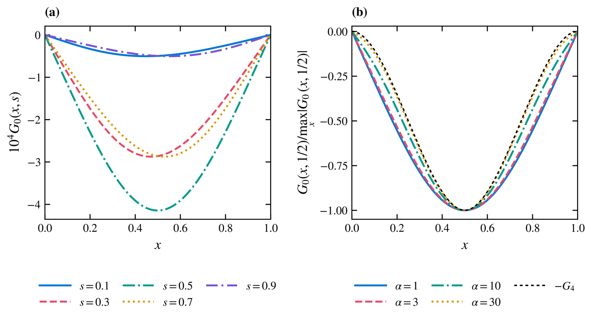</a></td><td><a href="figures/png/fig2_green_surface.png">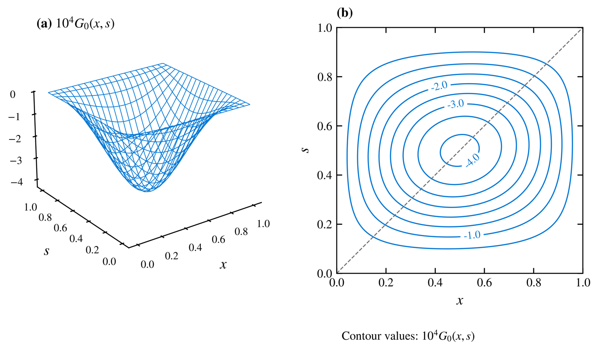</a></td></tr>
<tr><td><a href="figures/png/fig3_eta.png">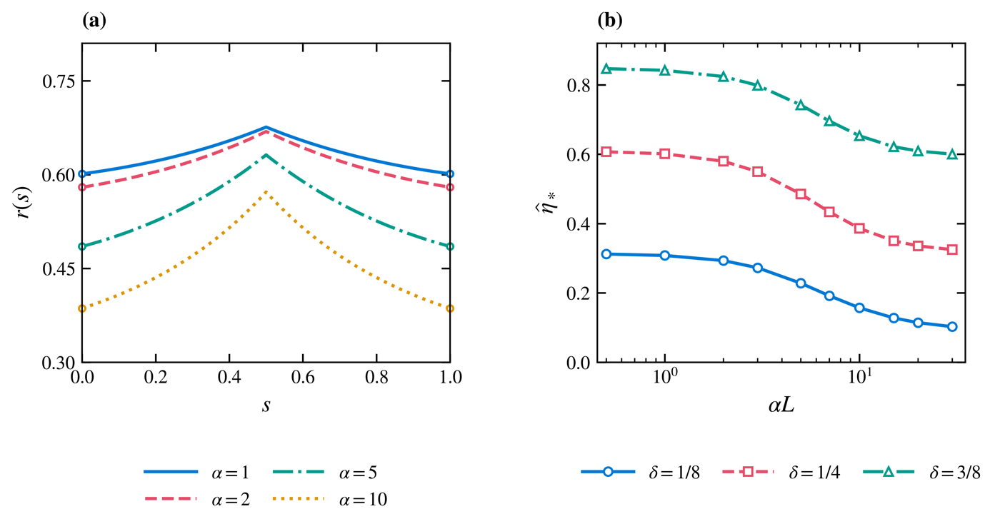</a></td><td><a href="figures/png/fig4_examples.png">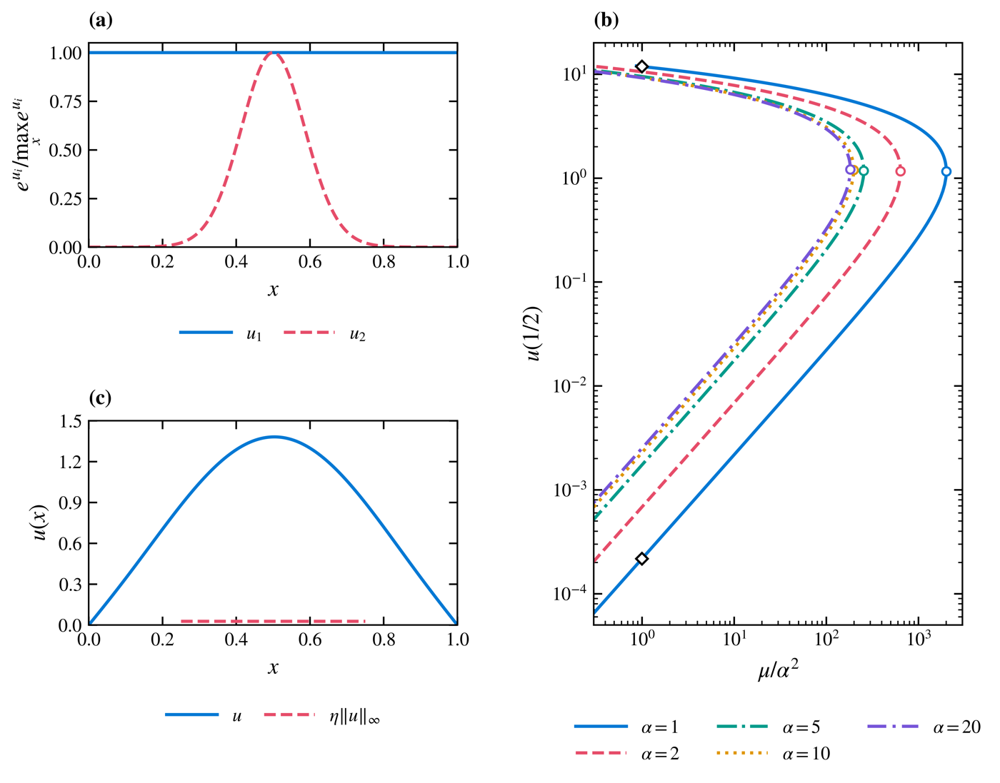</a></td></tr>
<tr><td><a href="figures/png/fig5_verification.png">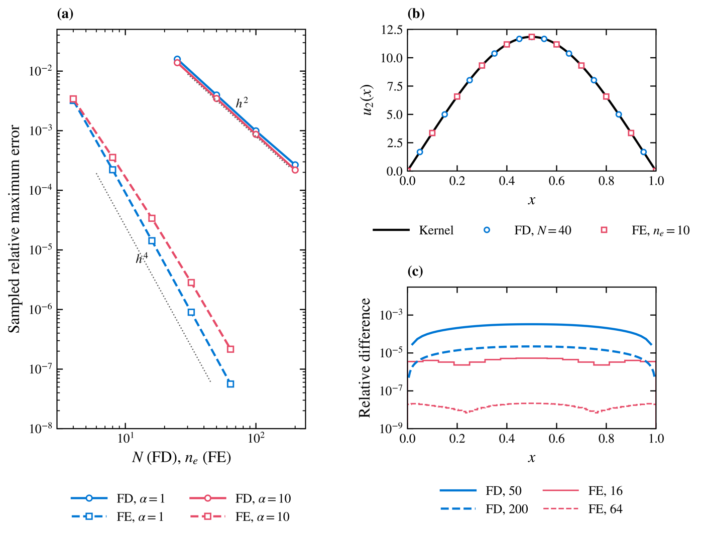</a></td><td><a href="figures/png/fig6_size_effect.png">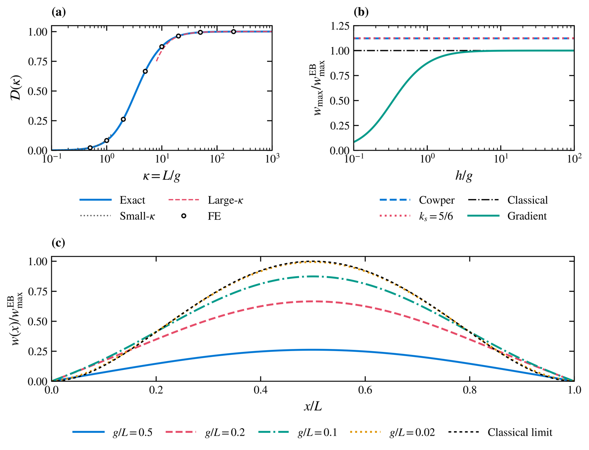</a></td></tr>
</table>

[PNG files](figures/png/) · [Vector SVG files](figures/svg/) · [Graphic-generation source](code/scripts/)

</details>

## Mathematical model

$$
-u^{(6)}+\alpha^2u^{(4)}=f(x,u),\qquad 0<x<L,
$$

with

$$
u=u''=0,\qquad u'''-\alpha^2u'=0\quad\text{at }x=0,L.
$$

These are **imposed factorized boundary constraints**. Their factorization combines a clamped fourth-order inverse with a Dirichlet Helmholtz inverse. The resulting positive kernel is `Gt`; the kernel `G0` of the opposite-sign operator is nonpositive. The kernel is generally nonsymmetric.

<details>
<summary>📐 Expand the kernel and cone formulas</summary>

The positive representation is

$$
\widetilde G(x,s)=\int_0^L[-G_2(x,\xi)]G_4(\xi,s)\,d\xi.
$$

An explicit analytically admissible cone constant is

$$
\eta_H=\frac{\sinh(\alpha\delta)}{\sinh(\alpha L)},\qquad 0<\delta<L/2.
$$

The existence examples use `eta=0.2` at `alpha=1` and `eta=0.02` at `alpha=5`. They do not rely on uncertified optimized constants. [Model and interpretation notes](docs/MODEL.md).

</details>

## Numerical results

| Example | Computed maximum | Interpretation |
|---|---:|---|
| Exponential load, small solution | 0.0002170814 | Positive equilibrium at `mu=1`, `alpha=1` |
| Exponential load, large solution | 11.84038788 | Second computed positive equilibrium |
| Quadratic load | 1.381653592 | `alpha=5`, `lambda=10000` |

📊 [Full numerical tables](docs/RESULTS.md) · 🔢 [Machine-readable results](code/results/results.json) · 🧮 [Independent audit data](code/results/audit.json)

The exponential sufficient load bound is `1/(e*A)`. The theoretical result guarantees at least two positive solutions below this bound. Computation does not establish that the plotted branches exhaust all possible solutions.

## Verification

**17 numerical tests**, **14 exact Green-kernel residual identities**, the fourth-order kernel normalization, high-precision constants, an asymmetric manufactured solution, and fold refinement are included in the verification workflow.

<details>
<summary>✅ Expand what is checked</summary>

- Six endpoint conditions, continuity through the fourth derivative and the unit fifth-derivative jump.
- Positive convolution agreement, kernel sign and small/large parameter evaluation.
- Regressions at `alpha=0.001` and `alpha=800`, where the previous evaluator failed.
- Uniform-load formula and both size-factor asymptotic coefficients.
- An asymmetric positive-load manufactured solution on `L=1.7`.
- Finite-difference and finite-element convergence, plus 48-to-64-point fold refinement.
- Local links, GIF motion, dimensions, file types and white-background raster exports.

[Verification notes](docs/VERIFICATION.md) · [Recorded logs](verification/) · [Change history](docs/CHANGELOG.md)

The workflow runs on pushes and pull requests. The included logs record local verification of this package.

</details>

## Repository map

| Path | Contents |
|---|---|
| `Green_Verification.py` | Stable compatible entry point with failure propagation |
| `code/sgbeam/` | Kernels, constants, three solvers and shear comparisons |
| `code/scripts/` | Numerical reproduction, symbolic checks, graphics and packaging checks |
| `code/tests/` | Numerical and regression tests |
| `code/results/` | JSON numerical results and animation data |
| `assets/animations/` | Original looping GIFs and media manifest |
| `assets/previews/` | PNG animation previews and figure thumbnails |
| `assets/navigation/`, `assets/badges/` | Original SVG navigation and badges |
| `figures/png/`, `figures/svg/` | High-resolution and vector figures |
| `docs/`, `verification/` | Scientific notes, numerical tables and verification evidence |

No manuscript LaTeX or PDF files are included. No external datasets or stock graphics were used. All media are generated from the project model by the supplied code.

## Citation

The companion manuscript is **Positive Solutions for a Sixth-Order Strain-Gradient Beam Boundary Value Problem**, by **Mahammad Khuddush**. Publication details are not asserted here. Software citation metadata are supplied in [CITATION.cff](CITATION.cff).

📄 [MIT license](LICENSE) · 🚀 [Updating the existing repository](docs/UPDATING.md) · 👤 [ORCID](https://orcid.org/0000-0002-1236-8334)
